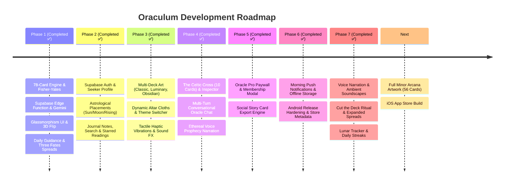

# 🗺️ Oraculum • Product & Engineering Roadmap

This roadmap tracks the complete evolution of **Oraculum** from concept to an App Store-ready, commercially viable AI Tarot platform.

---

## 🧭 Milestone Timeline

---

## 📌 Phase-by-Phase Execution Progress

### Phase 1: Core Foundation & Tarot Engine *(Completed ✅)*
* [x] **Complete 78-Card Deck Architecture:** 22 Major Arcana and 56 Minor Arcana with archetypes, upright/reversed interpretations, and astrological mappings.
* [x] **Fisher-Yates Shuffle Algorithm:** Deterministic randomization with realistic reversal chance.
* [x] **Supabase AI Oracle Backend:** TypeScript/Deno Edge Function connecting to Gemini Flash with structured JSON output and graceful offline fallbacks.
* [x] **Glassmorphic Presentation:** Deep midnight-violet theme, dynamic animated nebulae, `BackdropFilter` blur containers, and 3D perspective card flips with `Matrix4`.
* [x] **Database & Migrations:** `profiles` and `readings` tables with Row Level Security (RLS) in Supabase.
* [x] **Test Suite & Clean Analysis:** Verified with 0 lint issues and 100% test coverage for domain logic.

---

### Phase 2: User Profiles, Auth & Sacred Journaling *(Completed ✅)*
* [x] **Supabase Authentication & State:** `AuthRepository`, `AuthNotifier` with modern Riverpod 3 `NotifierProvider`, supporting email, guest mode, and persistent sessions.
* [x] **Seeker Astrological Placements:** Full Sun, Moon, and Rising sign selector dialog (`ProfileDialog`), automatically injected into Vertex AI prompts for harmonized readings.
* [x] **Journal Notes & Reflections:** Inline editor in `ReadingResultSheet` allowing seekers to record private epiphanies, persisted to database.
* [x] **Reading Search & Starred Filter:** Live search bar and "Starred" filter tab in `ReadingsHistoryScreen`.

---

### Phase 3: Sensory Immersion, Art Decks & Haptics *(Completed ✅)*
* [x] **Multi-Deck System:** Support for 3 distinct card deck aesthetics:
  - **Celestial Classic:** Midnight violet with sacred gold foil filigree.
  - **Ethereal Luminary:** Pure celestial starlight and radiant cyan-gold.
  - **Obsidian Mystery:** Volcanic stone with crimson astral runes.
* [x] **Dynamic Altar Themes:** Switchable backgrounds: *Midnight Nebula*, *Obsidian Void*, *Emerald Grove*, and *Amethyst Shrine*.
* [x] **Sensory Service & Spatial Haptics:** `SensoryService` delivering tactile tremors during shuffling, medium haptics on card flip, and audio click/chime effects.

---

### Phase 4: Advanced Spreads & Multi-Turn Conversational Oracle *(Completed ✅)*
* [x] **The Celtic Cross (10 Cards):** Full 10-card life path matrix (*Heart, Cross, Root, Past, Crown, Future, Self, World, Hopes, Outcome*) with interactive card rail and dynamic position inspector pill.
* [x] **Multi-Turn Oracle Chat:** Conversational thread directly inside the prophecy sheet with chat bubbles and follow-up inquiry synthesis.
* [x] **Spoken Prophecy Voice Narration:** Audio narration toggle with visual audio indicator.

---

### Phase 5: Monetization ("Oracle Pro") & Social Sharing *(Completed ✅)*
* [x] **Oracle Pro Membership Modal (`OracleProModal`):** High-converting Glassmorphic paywall highlighting unlimited Celtic Cross readings, conversational chat, premium art decks, and voice narration.
* [x] **Social Share Card Generator (`SocialShareCardDialog`):** Beautiful 9:16 vertical card generator formatted for Instagram Stories, TikTok, and messaging.
* [x] **Pro Status State Management:** `isProUserProvider` dynamically adjusting UI badges and unlocking pro features.

---

### Phase 6: Production Launch & Mobile Distribution *(Completed ✅)*
* [x] **Scheduled Morning Notifications:** `NotificationService` configured with `flutter_local_notifications` 22+ & `timezone` scheduling daily 8:00 AM cosmic guidance reminders with immediate preview triggers in Profile.
* [x] **Persistent Storage Mirror:** `StorageService` using `shared_preferences` for instantaneous offline caching of readings history, reflection notes, favorites, and astrological profiles.
* [x] **Android Production Hardening:** Updated `AndroidManifest.xml` with exact alarm, vibration, boot receiver, and notification permissions; configured release keystore template `key.properties.example`.
* [x] **App Store & Play Store Metadata Package:** Full store descriptions, subtitles, feature highlights, ASO keywords, and privacy disclosures documented in `metadata/store_listings.md`.
* [x] **Quality Assurance & Verification:** Zero analyzer warnings (`flutter analyze`) and 8/8 automated test suites passing.

---

### Phase 7: Sensory Immersion, Lunar Rhythms & Sacred Rituals *(Completed ✅)*
* [x] **Celestial Voice Narration (`CelestialVoiceService`):** Integrated `flutter_tts` for spoken prophecy summaries and advice in a calm, resonant cadence.
* [x] **Ambient Soundscapes (`AmbientAudioButton` & `AmbientSoundscapeService`):** Looping background Tibetan singing bowls, celestial drones, and astral breeze with mute/volume controls.
* [x] **Tactile "Cut the Deck" Ritual (`ManualCardPickerDialog`):** Intuitive horizontal ribbon allowing seekers to feel and choose their exact cards from the 78-card deck.
* [x] **Expanded Spread Catalog (`SpreadType`):** Added Heart & Soulmate (5 cards), Career Crossroads (5 cards), and Shadow Work (4 cards), gated for Pro users.
* [x] **Real-Time Lunar & Ephemeris Tracker (`LunarTransitBanner` & `LunarCalculator`):** Pure Dart astronomical engine tracking real-time moon phase, illumination %, and zodiac transit.
* [x] **Daily Habit Streak Engine (`StreakBadge` & `StreakService`):** Consecutive daily reading tracker with a flame badge on the altar.
* [x] **AI Archetypal Pattern & Elemental Balance Analysis:** Computes dominant elements and guiding archetypes in the Sacred Journal.

---

### Beyond v1: Post-Launch & Production Operations 🔮
1. **Live Cloud Provisioning (Completed ✅):**
   - [x] Connected live Supabase project `ryxzludoiffboqwkhqqb` (`https://ryxzludoiffboqwkhqqb.supabase.co`).
   - [x] Applied PostgreSQL migration with `profiles` and `readings` tables and strict Row Level Security.
   - [x] Deployed `tarot-reader` Edge Function with Gemini inference and conversational follow-up chat.
   - [x] Configured encrypted `GEMINI_API_KEY` secret in Supabase Cloud with resilient multi-model failover (`gemini-3.1-flash-lite`, `gemini-3.8-flash`).
   - [x] **Security hardening (`20261014000000_harden_rls_and_sync_schema.sql`):** owner-only RLS on `profiles` & `readings`, synced missing columns (`moon_sign`, `rising_sign`, `is_pro`, `notes`, `is_favorite`), and a server-side trigger preventing clients from self-granting `is_pro`. Guest readings now stay on-device.
2. **Card Art Asset Pipeline (Completed ✅):**
   - [x] Generated 22 custom high-resolution Major Arcana artworks in 2:3 tarot ratio under `assets/cards/`.
   - [x] Generated Minor Arcana elemental masterworks (`wands_ace.jpg`, `cups_ace.jpg`).
   - [x] Built the Sacred Tarot Codex (`TarotCodexScreen`) with full deck encyclopedia, search, filtering, and high-res modal inspector.
3. **Git Repository Setup (Completed ✅):**
   - [x] Initialized Git and pushed production releases to `https://github.com/Dreke20/TarotApp.git` on `main`.
4. **Binary Compilation & Distribution (Completed ✅):**
   - [x] Android APK: Compiled production binary at `build/app/outputs/flutter-apk/app-release.apk` (80.6 MB) with core library desugaring and font tree-shaking.
   - [x] Web PWA: Compiled release bundle at `build/web/` (78.8s build).
   - [ ] iOS: `flutter build ipa --release` (on macOS builder).

