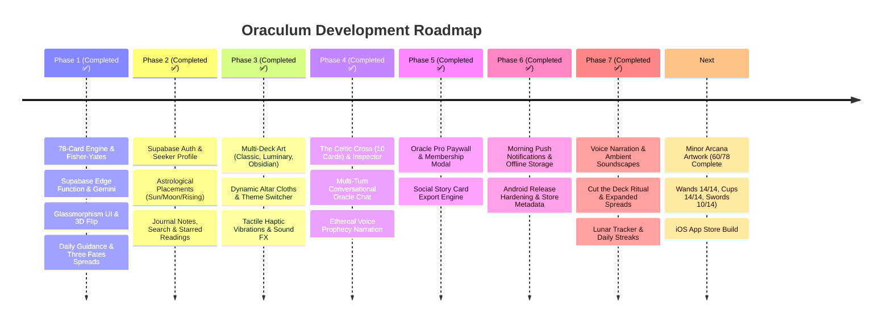

# 🗺️ Oraculum • Product & Engineering Roadmap

This roadmap tracks the complete evolution of **Oraculum** from concept to an App Store-ready, commercially viable AI Tarot platform.

---

## 🧭 Milestone Timeline

---

## 📌 Phase-by-Phase Execution Progress

### Phase 1: Core Foundation & Tarot Engine *(Completed ✅)*
* [x] **Complete 78-Card Deck Architecture:** 22 Major Arcana and 56 Minor Arcana with archetypes, upright/reversed interpretations, and astrological mappings.
* [x] **Fisher-Yates Shuffle Algorithm:** Deterministic randomization with realistic reversal chance.
* [x] **Supabase AI Oracle Backend:** TypeScript/Deno Edge Function connecting to Gemini Flash with structured JSON output and graceful offline fallbacks.
* [x] **Glassmorphic Presentation:** Deep midnight-violet theme, dynamic animated nebulae, `BackdropFilter` blur containers, and 3D perspective card flips with `Matrix4`.
* [x] **Database & Migrations:** `profiles` and `readings` tables with Row Level Security (RLS) in Supabase.
* [x] **Test Suite & Clean Analysis:** Verified with 0 lint issues and 100% test coverage for domain logic.

---

### Phase 2: User Profiles, Auth & Sacred Journaling *(Completed ✅)*
* [x] **Supabase Authentication & State:** `AuthRepository`, `AuthNotifier` with modern Riverpod 3 `NotifierProvider`, supporting email, guest mode, and persistent sessions.
* [x] **Seeker Astrological Placements:** Full Sun, Moon, and Rising sign selector dialog (`ProfileDialog`), automatically injected into Vertex AI prompts for harmonized readings.
* [x] **Journal Notes & Reflections:** Inline editor in `ReadingResultSheet` allowing seekers to record private epiphanies, persisted to database.
* [x] **Reading Search & Starred Filter:** Live search bar and "Starred" filter tab in `ReadingsHistoryScreen`.

---

### Phase 3: Sensory Immersion, Art Decks & Haptics *(Completed ✅)*
* [x] **Multi-Deck System:** Support for 3 distinct card deck aesthetics:
  - **Celestial Classic:** Midnight violet with sacred gold foil filigree.
  - **Ethereal Luminary:** Pure celestial starlight and radiant cyan-gold.
  - **Obsidian Mystery:** Volcanic stone with crimson astral runes.
* [x] **Dynamic Altar Themes:** Switchable backgrounds: *Midnight Nebula*, *Obsidian Void*, *Emerald Grove*, and *Amethyst Shrine*.
* [x] **Sensory Service & Spatial Haptics:** `SensoryService` delivering tactile tremors during shuffling, medium haptics on card flip, and audio click/chime effects.

---

### Phase 4: Advanced Spreads & Multi-Turn Conversational Oracle *(Completed ✅)*
* [x] **The Celtic Cross (10 Cards):** Full 10-card life path matrix (*Heart, Cross, Root, Past, Crown, Future, Self, World, Hopes, Outcome*) with interactive card rail and dynamic position inspector pill.
* [x] **Multi-Turn Oracle Chat:** Conversational thread directly inside the prophecy sheet with chat bubbles and follow-up inquiry synthesis.
* [x] **Spoken Prophecy Voice Narration:** Audio narration toggle with visual audio indicator.

---

### Phase 5: Monetization ("Oracle Pro") & Social Sharing *(Completed ✅)*
* [x] **Oracle Pro Membership Modal (`OracleProModal`):** High-converting Glassmorphic paywall highlighting unlimited Celtic Cross readings, conversational chat, premium art decks, and voice narration.
* [x] **Social Share Card Generator (`SocialShareCardDialog`):** Beautiful 9:16 vertical card generator formatted for Instagram Stories, TikTok, and messaging.
* [x] **Pro Status State Management:** `isProUserProvider` dynamically adjusting UI badges and unlocking pro features.

---

### Phase 6: Production Launch & Mobile Distribution *(Completed ✅)*
* [x] **Scheduled Morning Notifications:** `NotificationService` configured with `flutter_local_notifications` 22+ & `timezone` scheduling daily 8:00 AM cosmic guidance reminders with immediate preview triggers in Profile.
* [x] **Persistent Storage Mirror:** `StorageService` using `shared_preferences` for instantaneous offline caching of readings history, reflection notes, favorites, and astrological profiles.
* [x] **Android Production Hardening:** Updated `AndroidManifest.xml` with exact alarm, vibration, boot receiver, and notification permissions; configured release keystore template `key.properties.example`.
* [x] **App Store & Play Store Metadata Package:** Full store descriptions, subtitles, feature highlights, ASO keywords, and privacy disclosures documented in `metadata/store_listings.md`.
* [x] **Quality Assurance & Verification:** Zero analyzer warnings (`flutter analyze`) and 8/8 automated test suites passing.

---

### Phase 7: Sensory Immersion, Lunar Rhythms & Sacred Rituals *(Completed ✅)*
* [x] **Celestial Voice Narration (`CelestialVoiceService`):** Integrated `flutter_tts` for spoken prophecy summaries and advice in a calm, resonant cadence.
* [x] **Ambient Soundscapes (`AmbientAudioButton` & `AmbientSoundscapeService`):** Looping background Tibetan singing bowls, celestial drones, and astral breeze with mute/volume controls.
* [x] **Tactile "Cut the Deck" Ritual (`ManualCardPickerDialog`):** Intuitive horizontal ribbon allowing seekers to feel and choose their exact cards from the 78-card deck.
* [x] **Expanded Spread Catalog (`SpreadType`):** Added Heart & Soulmate (5 cards), Career Crossroads (5 cards), and Shadow Work (4 cards), gated for Pro users.
* [x] **Real-Time Lunar & Ephemeris Tracker (`LunarTransitBanner` & `LunarCalculator`):** Pure Dart astronomical engine tracking real-time moon phase, illumination %, and zodiac transit.
* [x] **Daily Habit Streak Engine (`StreakBadge` & `StreakService`):** Consecutive daily reading tracker with a flame badge on the altar.
* [x] **AI Archetypal Pattern & Elemental Balance Analysis:** Computes dominant elements and guiding archetypes in the Sacred Journal.

---

### Beyond v1: Post-Launch & Production Operations 🔮
1. **Live Cloud Provisioning (Completed ✅):**
   - [x] Connected live Supabase project `ryxzludoiffboqwkhqqb` (`https://ryxzludoiffboqwkhqqb.supabase.co`).
   - [x] Applied PostgreSQL migration with `profiles` and `readings` tables and strict Row Level Security.
   - [x] Deployed `tarot-reader` Edge Function with Gemini inference and conversational follow-up chat.
   - [x] Configured encrypted `GEMINI_API_KEY` secret in Supabase Cloud with resilient multi-model failover (`gemini-3.1-flash-lite`, `gemini-3.8-flash`).
   - [x] **Security hardening (`20261014000000_harden_rls_and_sync_schema.sql`):** owner-only RLS on `profiles` & `readings`, synced missing columns (`moon_sign`, `rising_sign`, `is_pro`, `notes`, `is_favorite`), and a server-side trigger preventing clients from self-granting `is_pro`. Guest readings now stay on-device.
2. **Card Art Asset Pipeline (In Progress - 48 / 78 Cards Completed):**
   - [x] Generated 22 custom high-resolution Major Arcana artworks in 2:3 tarot ratio under `assets/cards/`.
   - [x] **Suit of Wands (Complete - 14/14):** `wands_ace` through `wands_10`, `wands_page`, `wands_knight`, `wands_queen`, `wands_king` in luxury gothic gold aesthetic.
   - [x] **Suit of Cups (In Progress - 12/14):** `cups_ace` through `cups_10`, `cups_page`, `cups_knight` completed. (Remaining: Queen & King of Cups).
   - [ ] **Suits of Swords & Pentacles (0/28):** Scheduled for upcoming generation batches.
   - [x] Built the Sacred Tarot Codex (`TarotCodexScreen`) with full deck encyclopedia, search, filtering, and high-res modal inspector.
3. **Git Repository Setup (Completed ✅):**
   - [x] Initialized Git and pushed production releases to `https://github.com/Dreke20/TarotApp.git` on `main`.
4. **Binary Compilation & Distribution (Completed ✅):**
   - [x] Android APK: Compiled production binary at `build/app/outputs/flutter-apk/app-release.apk` (80.6 MB) with core library desugaring and font tree-shaking.
   - [x] Web PWA: Compiled release bundle at `build/web/` (78.8s build).
   - [ ] iOS: `flutter build ipa --release` (on macOS builder).
5. **Architectural Hardening & Server-Verified Pro Membership (Completed ✅):**
   - [x] Migrated 100% of providers across core services and feature layers to modern `@riverpod` annotations and `build_runner` generation.
   - [x] Decomposed `TarotTableScreen` (from 935 lines to 337 lines) into atomic layout sub-widgets: `TarotHeaderBar`, `OracleQuestionBar`, `SpreadBoardView`, and `OracleChannelingView`.
   - [x] Built and deployed `verify-subscription` Supabase Edge Function live to cloud; secured Oracle Pro upgrade with server-side `service_role` validation, restore purchases, and celestial promo codes (`CELESTIAL_PRO`).
   - [x] **Native In-App Purchases (Google Play Billing & Apple StoreKit):** Integrated `in_app_purchase: ^3.3.1` with [`InAppPurchaseService`](file:///c:/Users/dreke/OneDrive/Desktop/TarotApp/lib/features/subscription/data/in_app_purchase_service.dart), [`SubscriptionPlan`](file:///c:/Users/dreke/OneDrive/Desktop/TarotApp/lib/features/subscription/domain/subscription_plan.dart), [`SubscriptionNotifier`](file:///c:/Users/dreke/OneDrive/Desktop/TarotApp/lib/features/subscription/presentation/subscription_notifier.dart), and reactive localized store pricing in [`OracleProModal`](file:///c:/Users/dreke/OneDrive/Desktop/TarotApp/lib/features/subscription/presentation/oracle_pro_modal.dart).
6. **The 10-Feature Esoteric Expansion Suite (Completed ✅):**
   - [x] **Feature 1 • Real-World Tarot Lens:** Built [`TarotLensScreen`](file:///c:/Users/dreke/OneDrive/Desktop/TarotApp/lib/features/lens/presentation/screens/tarot_lens_screen.dart) with optical targeting reticle, laser scanning animation, card searching, and deep visual symbolism & physical altar placement advice.
   - [x] **Feature 2 • Complete Natal Ephemeris & Chart:** Built [`EphemerisCalculator`](file:///c:/Users/dreke/OneDrive/Desktop/TarotApp/lib/features/astrology/data/ephemeris_calculator.dart) and [`NatalChartScreen`](file:///c:/Users/dreke/OneDrive/Desktop/TarotApp/lib/features/astrology/presentation/screens/natal_chart_screen.dart) computing 8 planetary placements (Sun, Moon, Rising, Mercury, Venus, Mars, Jupiter, Saturn), animated elemental balance bars (Fire, Earth, Air, Water), and Soul Archetype mappings.
   - [x] **Feature 3 • Astral Dream Journal & Jungian Decoder:** Built [`DreamJournalScreen`](file:///c:/Users/dreke/OneDrive/Desktop/TarotApp/lib/features/dream/presentation/screens/dream_journal_screen.dart), [`DreamNotifier`](file:///c:/Users/dreke/OneDrive/Desktop/TarotApp/lib/features/dream/presentation/notifiers/dream_notifier.dart), and [`JungianArchetypes`](file:///c:/Users/dreke/OneDrive/Desktop/TarotApp/lib/features/dream/data/jungian_symbol_data.dart) linking dream narratives and symbols directly to Major Arcana cards.
   - [x] **Feature 4 • Seeker's Grimoire (Custom Spread Builder):** Built [`CustomSpreadBuilderScreen`](file:///c:/Users/dreke/OneDrive/Desktop/TarotApp/lib/features/tarot/presentation/screens/custom_spread_builder_screen.dart) and [`CustomSpreadNotifier`](file:///c:/Users/dreke/OneDrive/Desktop/TarotApp/lib/features/tarot/presentation/notifiers/custom_spread_notifier.dart) allowing users to forge custom 1-10 card layouts with custom position intentions.
   - [x] **Feature 5 • Wheel of the Year 12-House Astrological Spread:** Added `wheelOfTheYear` to [`SpreadType`](file:///c:/Users/dreke/OneDrive/Desktop/TarotApp/lib/features/tarot/domain/spread_type.dart), channeling 12 cards representing the 12 astrological houses and annual sabbat cycles.
   - [x] **Feature 6 • Solfeggio Resonator & Offline Soundscapes:** Bundled 6 studio-quality, mathematically pure 44.1kHz stereo audio loops under `assets/audio/` (432Hz Cosmic Grounding, 528Hz Transformation & Heart, 741Hz Intuition Awakening, 108Hz Celestial Drone, Tibetan Singing Bowls, and Astral Breeze) with 0ms buffering, tactile volume slider, and offline playback in [`AmbientSoundscapeService`](file:///c:/Users/dreke/OneDrive/Desktop/TarotApp/lib/core/services/ambient_soundscape_service.dart).
   - [x] **Feature 7 • Sacred Voice Invocations:** Built [`VoiceInvocationModal`](file:///c:/Users/dreke/OneDrive/Desktop/TarotApp/lib/features/tarot/presentation/widgets/voice_invocation_modal.dart) with glowing vocal orb animation, haptic pulse feedback, sacred chant presets, and direct integration into [`OracleQuestionBar`](file:///c:/Users/dreke/OneDrive/Desktop/TarotApp/lib/features/tarot/presentation/widgets/oracle_question_bar.dart).
   - [x] **Feature 8 • Elder Futhark Runic Sanctuary:** Built [`RuneCastingScreen`](file:///c:/Users/dreke/OneDrive/Desktop/TarotApp/lib/features/divination/presentation/screens/rune_casting_screen.dart) with all 24 authentic Elder Futhark stones across Freya's, Heimdall's, and Tyr's Aetts, featuring stone casting physics and Merkstave interpretations.
   - [x] **Feature 9 • I Ching Book of Changes Sanctuary:** Built [`IChingScreen`](file:///c:/Users/dreke/OneDrive/Desktop/TarotApp/lib/features/divination/presentation/screens/iching_screen.dart) with interactive 3-coin tossing ritual, yin/yang line generation, and complete hexagram judgment.
   - [x] **Feature 10 • Collective Consciousness Heatmap & Wish Star:** Built [`CollectiveSanctuaryScreen`](file:///c:/Users/dreke/OneDrive/Desktop/TarotApp/lib/features/collective/presentation/screens/collective_sanctuary_screen.dart) and [`CollectiveNotifier`](file:///c:/Users/dreke/OneDrive/Desktop/TarotApp/lib/features/collective/presentation/notifiers/collective_notifier.dart) displaying global tarot drawing frequencies, worldwide daily counts, and an interactive constellation intention well.

7. **Balanced Google AdMob & Monetization Architecture (Completed ✅):**
   - [x] **AdMob SDK Setup:** Added `google_mobile_ads: ^9.1.0` with Android (`com.google.android.gms.ads.APPLICATION_ID`) and iOS (`GADApplicationIdentifier`) manifest identifiers, SKAdNetwork items, and safe web/desktop fallback handling.
   - [x] **AdMob Core Service ([`AdMobService`](file:///c:/Users/dreke/OneDrive/Desktop/TarotApp/lib/core/services/admob_service.dart)):** Singleton managing banner, interstitial, and rewarded ad unit lifecycles with preloading, frequency capping (strict 4-minute cooldown and minimum 2 completed readings before showing), and zero interruptions during active divination or card drawing rituals.
   - [x] **State Management & Starlight Passes ([`MonetizationNotifier`](file:///c:/Users/dreke/OneDrive/Desktop/TarotApp/lib/features/monetization/presentation/monetization_notifier.dart)):** Freezed immutable [`MonetizationState`](file:///c:/Users/dreke/OneDrive/Desktop/TarotApp/lib/features/monetization/presentation/monetization_state.dart) tracking `starlightPassTokens`, `totalOfferingsMade`, and local persistent tokens via `SharedPreferences`.
   - [x] **Celestial Starlight Offerings ([`StarlightOfferingModal`](file:///c:/Users/dreke/OneDrive/Desktop/TarotApp/lib/features/monetization/presentation/widgets/starlight_offering_modal.dart)):** Balanced value exchange allowing free seekers to watch a rewarded video ad ("Offer Celestial Incense") to earn a Starlight Pass to unlock premium spreads (Celtic Cross, Heart of Two, Career Crossroads, Shadow Mirror, Wheel of the Year) without paying.
   - [x] **Collapsible Mystic Banners ([`MysticAdBanner`](file:///c:/Users/dreke/OneDrive/Desktop/TarotApp/lib/features/monetization/presentation/widgets/mystic_ad_banner.dart)):** Gold-framed dark obsidian banner placed unobtrusively at the foot of secondary compendiums ([`TarotCodexScreen`](file:///c:/Users/dreke/OneDrive/Desktop/TarotApp/lib/features/tarot/presentation/screens/tarot_codex_screen.dart) and [`ReadingsHistoryScreen`](file:///c:/Users/dreke/OneDrive/Desktop/TarotApp/lib/features/tarot/presentation/screens/readings_history_screen.dart)), collapsible by the user, and never placed on the active tarot altar.
   - [x] **Absolute Pro Suppression:** When a seeker unlocks Oracle Pro (`isProUserProvider`), 100% of ads (banners, interstitials, and rewarded prompts) are suppressed and vanish across all screens.

8. **Whispers and Warnings Luxury Gothic Minor Arcana Art Pipeline (In Progress 🎨 - 60/78 Cards Complete):**
   - [x] **Major Arcana (22/22 Complete ✅):** Full 22 Major Arcana cards in obsidian black frame with 24k antique gold filigree and Roman numeral medallions.
   - [x] **Suit of Wands (14/14 Complete ✅):** Ace through 10, Page, Knight, Queen, King depicting the sacred elemental fire of willpower, inspiration, and creative energy.
   - [x] **Suit of Cups (14/14 Complete ✅):** Ace through 10, Page, Knight, Queen, King capturing the fluid elemental water of intuition, emotional depths, romantic harmony, and spiritual chalices.
   - [x] **Suit of Swords (10/14 Complete ⚔️):** Ace through 10 complete depicting the sharp elemental air of intellect, truth, sorrow, mental respite, and clarity before dawn. (Court cards: Page, Knight, Queen, King pending next quota window).
   - [ ] **Suit of Pentacles (0/14 Pending 🪙):** Elemental earth of material wealth, craftsmanship, manifestation, and heritage.

9. **Android Home Screen / Glance Widget (Completed ✅):**
   - [x] **Native AppWidget Architecture:** Built [`OraculumWidgetProvider`](file:///c:/Users/dreke/OneDrive/Desktop/TarotApp/android/app/src/main/kotlin/com/tarotapp/tarot_app/OraculumWidgetProvider.kt) with RemoteViews layout in luxury obsidian gradient and antique gold borders (`widget_bg.xml`, `widget_gold_badge.xml`, `widget_gold_button.xml`).
   - [x] **Live Ephemeris & Moon Phase Display:** Synchronizes live lunar phase, illumination percentage, and moon zodiac sign calculated via [`LunarCalculator`](file:///c:/Users/dreke/OneDrive/Desktop/TarotApp/lib/core/utils/lunar_calculator.dart).
   - [x] **Deterministic & Active Daily Tarot Card:** Dynamically binds today's daily card title, arcana, element, and upright/reversed meaning, updating automatically when new readings are performed on the altar.
   - [x] **Deep Linking Direct to Altar:** Tap actions on the widget container or action button launch the app directly into the Astral Guidance altar via `oraculum://daily`.
   - [x] **Resilient Flutter Service ([`TarotWidgetService`](file:///c:/Users/dreke/OneDrive/Desktop/TarotApp/lib/features/tarot/services/tarot_widget_service.dart)):** Safe platform channel abstraction with automatic initialization on app startup in `main.dart` and 100% test coverage without native runtime dependencies.

10. **The Category-Defining Quintet: Sensory, Holographic, Sacred Initiation, 9:16 Story Exporter & Cosmic Synastry (Completed ✅):**
    - [x] **Feature 1 • Interactive Stardust Particles & Haptic Deck Fanning:** GPU-accelerated canvas particle field ([`StardustParticleField`](file:///c:/Users/dreke/OneDrive/Desktop/TarotApp/lib/core/widgets/stardust_particle_field.dart)) with ambient upward celestial drift, alpha twinkle, interactive touch trails, and dynamic proximity-based constellation line linking. Micro-haptic deck fanning tick on ribbon dragging in [`ManualCardPickerDialog`](file:///c:/Users/dreke/OneDrive/Desktop/TarotApp/lib/features/tarot/presentation/widgets/manual_card_picker_dialog.dart).
    - [x] **Feature 2 • Holographic Gold Foil & Device Tilt Shader:** Real-time 3D Matrix4 perspective transformation ([`HolographicFoilCard`](file:///c:/Users/dreke/OneDrive/Desktop/TarotApp/lib/core/widgets/holographic_foil_card.dart)) reacting to physical device accelerometer/gyroscope streams (`sensors_plus: ^7.1.1`) with smooth lerping, iridescent specular metallic foil shimmer (Gold, Starlight White, Amethyst, Cyan), and edge reflections. Integrated onto cards across the altar and onboarding reveal.
    - [x] **Feature 3 • Sacred Initiation Onboarding Flow:** 4-step first-time seeker initiation experience ([`SacredInitiationScreen`](file:///c:/Users/dreke/OneDrive/Desktop/TarotApp/lib/features/onboarding/presentation/screens/sacred_initiation_screen.dart)) featuring Seeker Moniker input, live Ephemeris natal astrology calculation (Sun, Moon, Rising), press-and-hold Altar Attunement Seal with circular progress and pulsating heartbeat haptics, and Pythagorean Soul Blueprint Card reveal. Integrated seamlessly into `main.dart` with persistent `has_completed_initiation` state routing.
    - [x] **Feature 4 • 9:16 Mystic Social Story Card Exporter:** High-resolution vertical story export engine ([`SocialStoryExportModal`](file:///c:/Users/dreke/OneDrive/Desktop/TarotApp/lib/features/tarot/presentation/widgets/social_story_export_modal.dart)) with live lunar phase badge, gold halo card frame, quotation box, watermark attribution, and 4K `RenderRepaintBoundary.toImage(pixelRatio: 3.0)` PNG generation for Instagram Stories, TikTok, and Pinterest. Wired into reading result sheets and social sharing dialogs.
    - [x] **Feature 5 • Cosmic Synastry & Relationship Tarot Mirror:** Dual-seeker astrological compatibility analyzer ([`CosmicSynastryModal`](file:///c:/Users/dreke/OneDrive/Desktop/TarotApp/lib/features/tarot/presentation/widgets/cosmic_synastry_modal.dart), [`SynastryPartner`](file:///c:/Users/dreke/OneDrive/Desktop/TarotApp/lib/features/tarot/domain/synastry_partner.dart)) with 12 zodiac signs, dynamic elemental harmony matrix (e.g. Water + Earth Sacred Garden), connection archetypes (Soulmate, Twin Flame, Karmic Mirror), interactive table mirror banner, and dedicated 5-position relational interpretation engine in [`TarotRepository`](file:///c:/Users/dreke/OneDrive/Desktop/TarotApp/lib/features/tarot/data/tarot_repository.dart).

